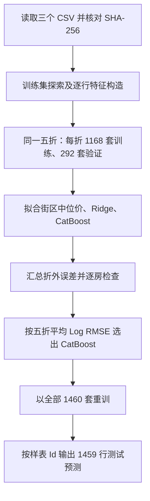
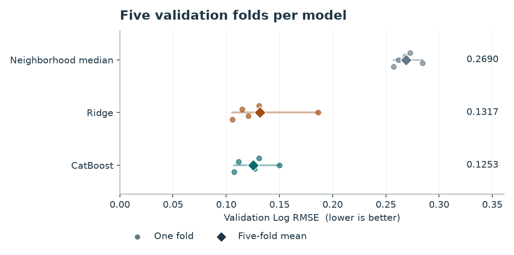
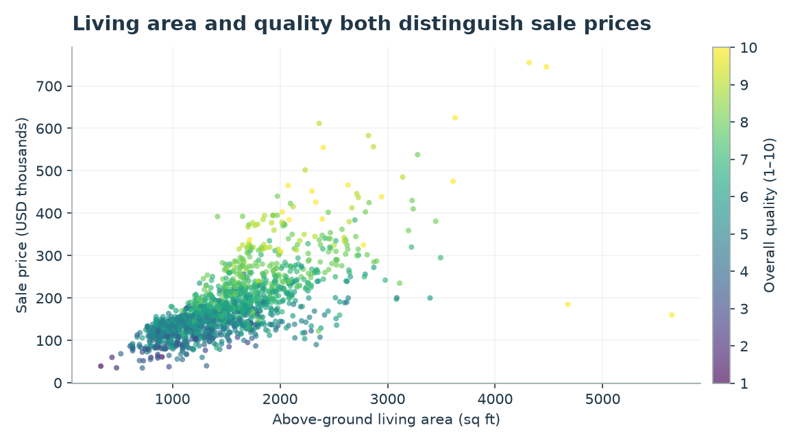

# Ames 房价预测

给定美国爱荷华州 Ames 市一套房屋的面积、质量、街区和交易属性，能把成交价估到多准？项目用 2006–2010 年的 1,460 笔已知成交比较街区中位价、Ridge 和 CatBoost，再为 1,459 套竞赛测试房屋生成美元估价。预测目标 `SalePrice` 是连续金额，因此采用回归模型。

## 一分钟看结果

三个模型使用同一组五折。每套训练房屋都由**未见过它的模型**估价一次，得到折外预测（OOF）。下表前两列分数基于五个验证折，后两列误差基于全部 1,460 笔折外预测。各列均越低越好。

| 模型 | 五折平均 Log RMSE | 折间样本标准差 | 折外 MAE（美元） | 绝对百分比误差中位数 |
|---|---:|---:|---:|---:|
| 街区中位价 | 0.268978 | 0.010472 | 36,232 | 14.58% |
| Ridge | 0.131703 | 0.031950 | 15,414 | 5.61% |
| **CatBoost** | **0.125347** | **0.016982** | **14,859** | **5.58%** |

CatBoost 的五折平均 Log RMSE 较街区基线低 **53.40%**，较 Ridge 低 **4.83%**。它每折都胜过街区基线，对 Ridge 的优势来自第 2、3 折，尤其是第 3 折。把所有折外预测合并后计算，CatBoost 的 Log RMSE 为 **0.126264**。[模型汇总](results/model_comparison.csv) · [逐折成绩](results/fold_scores.csv)

**尚未获得官方榜单成绩。** 下方另有已经完成的融合扩展，其平均 Log RMSE 为 0.118185，使用同一组五折。[扩展实验](extensions/ensemble/README.md)

## 十分钟审阅路线

| 想核对什么 | 从哪里看 |
|---|---|
| 模型看到了哪些信息，如何避免验证标签泄漏 | [实验报告](docs/experiment_report.md) 第 2–5 节、[主 Notebook](house_prices.ipynb) 第 1–4 节 |
| CatBoost 为什么平均领先 Ridge，五折是否稳定 | [逐折成绩](results/fold_scores.csv)、[实验报告](docs/experiment_report.md) 第 7 节 |
| 一套房会错多少，哪几套房影响最大 | [逐房误差表](results/catboost_errors.csv)、[实验报告](docs/experiment_report.md) 第 8 节 |
| 如何复算每个数字，与什么对照过 | [独立核验脚本](scripts/verify_results.py)、[实际运行记录](docs/verification.md) |

## 数据与建模流程

Kaggle House Prices 使用 Ames 历史住宅交易数据。训练表有 `Id`、79 个原始预测字段和 `SalePrice`，测试表使用同样的 79 个字段和 `Id`，真实价格由比赛方保留。主要字段包括面积 `GrLivArea`、地段 `Neighborhood`、质量 `OverallQual`、建造时间 `YearBuilt`、车库 `GarageCars` 和成交条件 `SaleCondition`。面积单位为平方英尺，价格为成交当时的美元。`Id` 用来关联数据和对齐样表。[竞赛数据与字段说明](https://www.kaggle.com/competitions/house-prices-advanced-regression-techniques/data)



- **输入处理**。代码区分设施缺失和未知类别，构造房龄、翻修间隔、总室内面积、加权卫浴数和门廊总面积。部分长尾面积特征使用 `log1p`。
- **三个模型**。街区基线使用训练折的中位成交价。Ridge 在训练折拟合数值插补、标准化和独热编码。CatBoost 直接接收类别字段。后两者学习 `ln(SalePrice)`，估价时取指数还原美元。
- **选模与交付**。每个候选共享种子 42 的五折，以平均 Log RMSE 最低者全量重训。测试预测按样表次序回读核对。[提交文件](results/submission.csv)

## 两张图看懂模型的长处与短处



Ridge 在三折上略胜，但第 3 折达到 0.186495，CatBoost 同折为 0.150087。这一折拉开了两者的平均分。



面积与成交价的 Spearman 相关系数为 0.731。右侧两笔大面积交易的成交价分别只有 184,750 和 160,000 美元。CatBoost 对两笔都明显高估，它们合计贡献第 3 折 **44.41%** 的对数平方误差。全部折外房屋中，绝对百分比误差的第 90 百分位为 **16.61%**。[全部图表](results/figures/) · [难例明细](results/catboost_errors.csv)

## 从头运行

参考环境为 **CPython 3.13.14、CPU**。CatBoost 每次拟合使用 4 个 CPU 线程。在仓库根目录操作。Windows PowerShell 可直接调用虚拟环境的解释器和执行器，无需改变脚本执行策略。

```powershell
python -m venv .venv
$env:PYTHONUTF8 = '1'
.\.venv\Scripts\python.exe -m pip install -r requirements.txt
.\.venv\Scripts\jupyter.exe execute --inplace --timeout=900 house_prices.ipynb
.\.venv\Scripts\python.exe scripts/verify_results.py
```

macOS 或 Linux 使用以下形式激活虚拟环境后执行。

```bash
python3 -m venv .venv
source .venv/bin/activate
python -m pip install -r requirements.txt
jupyter execute --inplace --timeout=900 house_prices.ipynb
python scripts/verify_results.py
```

**数据放置。** 可从比赛 Data 页面下载并解压，把 `train.csv`、`test.csv`、`sample_submission.csv` 放入仓库根目录的 `data/`，也可用 `HOUSE_PRICES_DATA_DIR` 指定包含三者的目录。未指定时，代码依次查找本地 `data/`、Kaggle 挂载目录和固定第 1 版的公开归档。加载后统一换行并核对每个文件的 SHA-256。完整原始数据可按此方式获取。[比赛数据](https://www.kaggle.com/competitions/house-prices-advanced-regression-techniques/data) · [公开归档](https://www.kaggle.com/datasets/shadalishah/house-prices-advanced-regression-techniques)

**产物与核验。** 默认写入 `results/`，其中有五份 CSV 和六张 PNG。`--inplace` 将运行输出同时写回 Notebook。在本地备好原始文件后，可用 `python scripts/verify_results.py --data-dir data` 额外核对成交价、街区基线、难例属性和样表。用 `HOUSE_PRICES_OUTPUT_DIR` 切换实验输出位置后，给核验脚本加 `--results` 指向同一目录。在 Kaggle 导入 Notebook、挂载同样的三份文件，再点 **Run All**。[实际运行记录](docs/verification.md)

## 仓库结构

```text
.
├── README.md                      项目入口与复现步骤
├── house_prices.ipynb             三模型主实验，附运行输出
├── requirements.txt               训练、绘图与执行的依赖版本
├── results/
│   ├── model_comparison.csv       五折、汇总折外指标及 P90
│   ├── fold_scores.csv            三模型 × 五折的 15 行成绩
│   ├── oof_predictions.csv        每套训练房屋的真实价、折号和三个估价
│   ├── catboost_errors.csv        按百分比误差排序，含属性、方向及折内误差贡献
│   ├── submission.csv             面向 Kaggle 的 CatBoost 测试估价
│   └── figures/                   六张主实验图
├── scripts/verify_results.py      从逐房数据独立复算结果
├── docs/
│   ├── experiment_report.md       方法、公式、逐折结果与失败分析
│   └── verification.md            执行环境、核验范围与数值核对
├── extensions/ensemble/           后续融合实验的代码和结果，清单见该目录 README
├── .gitignore                     原始数据、环境、凭证与缓存的排除规则
└── .gitattributes                 统一文本换行，保留 CSV 与 PNG 的原始字节
```

## 局限与参考

随机五折混合了 2006–2010 年的交易，外推至其他城市或时期需要当地数据。极少数特殊交易会拉大平方误差。同一套五折兼用于选模和评估，平均分可能偏乐观。后续融合实验已完成一次按年检查，系统特征消融和多随机种子重复验证仍待完成。[实验报告](docs/experiment_report.md) · [融合及按年验证](extensions/ensemble/README.md)

数据背景来自 Dean De Cock 的 Ames Housing 教学研究。Kaggle 采用其竞赛划分，《动手学深度学习》提供了同一划分的教学案例。Ridge、五折和 CatBoost 分别采用 scikit-learn 与 CatBoost 的现成实现。[Ames Housing 原始论文](https://jse.amstat.org/v19n3/decock.pdf) · [教材案例](https://d2l.ai/chapter_multilayer-perceptrons/kaggle-house-price.html) · [Ridge](https://scikit-learn.org/stable/modules/generated/sklearn.linear_model.Ridge.html) · [KFold](https://scikit-learn.org/stable/modules/generated/sklearn.model_selection.KFold.html) · [CatBoostRegressor](https://catboost.ai/docs/en/concepts/python-reference_catboostregressor)
