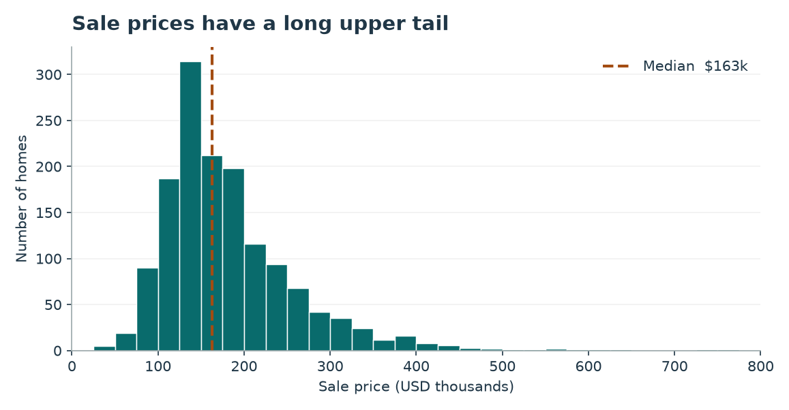
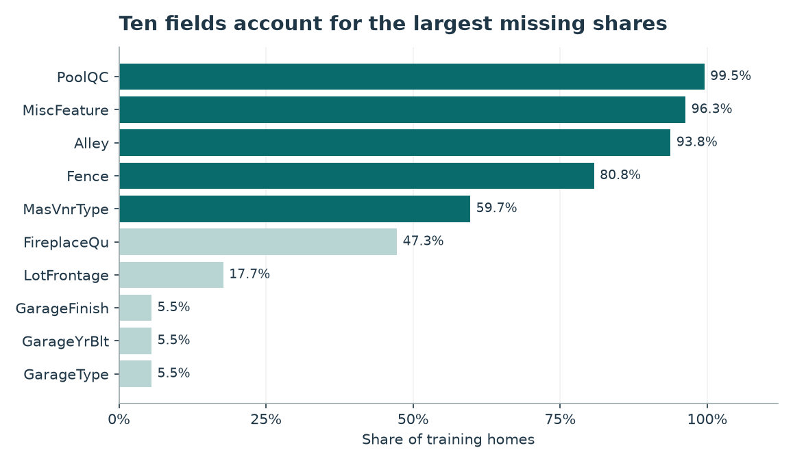
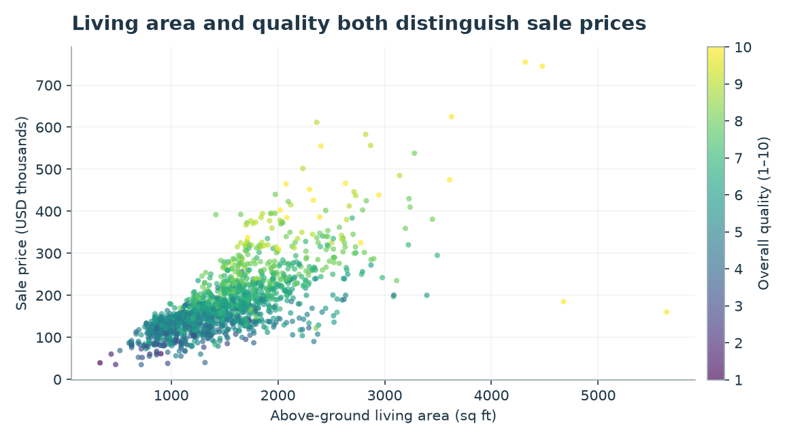
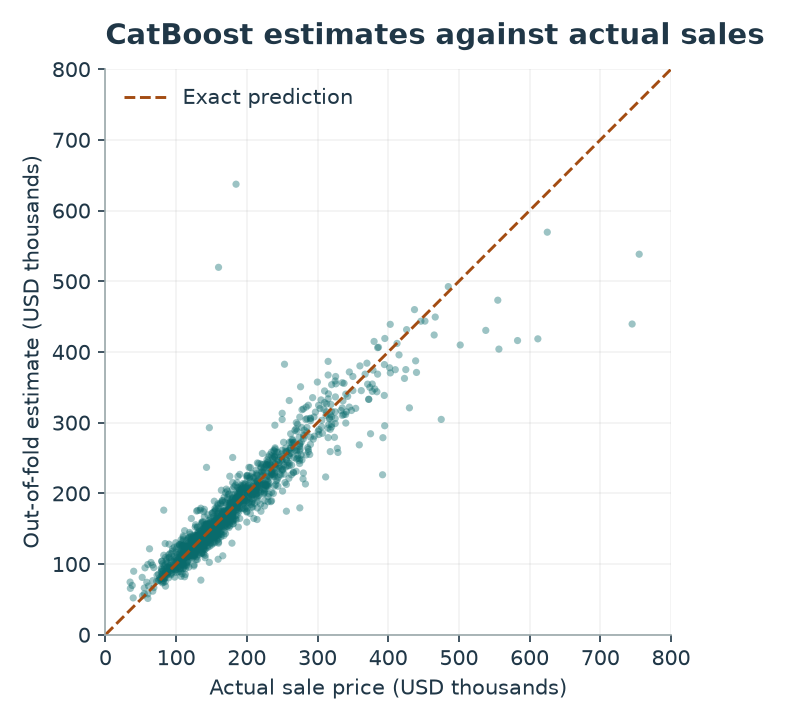
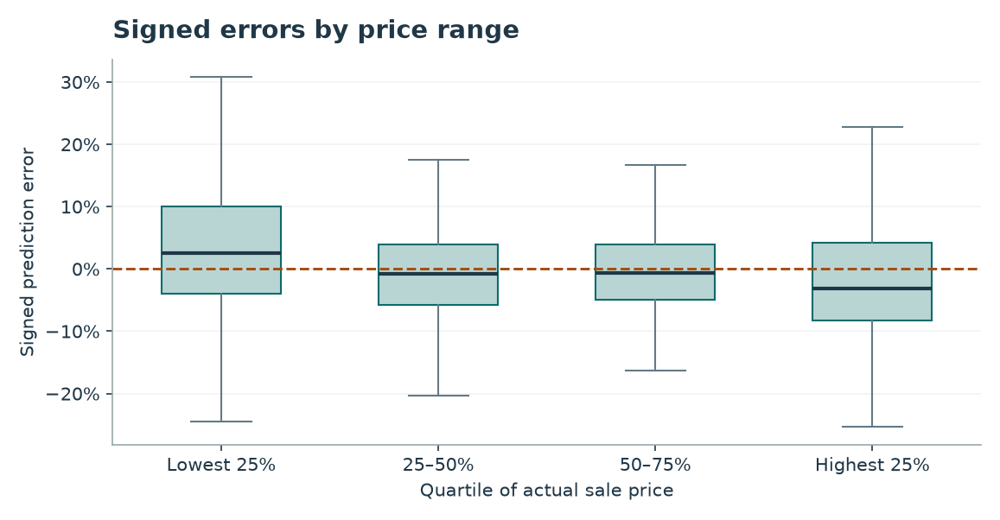

# 实验报告｜一套 Ames 住宅能估到多准？

主实验比较三种估价方法。CatBoost 的平均绝对误差为 14,859 美元，但这个平均数同时包含误差很小的普通房屋和少数高估超过 35 万美元的交易。下面沿着一次真实预测所需的步骤，说明分数从何而来。[主 Notebook](../house_prices.ipynb) · [模型比较](../results/model_comparison.csv) · [实际运行记录](verification.md)

## 1. 问题与数据边界

输入是 Ames 历史住宅的结构、设施、位置和交易属性。预测时使用测试表中给出的字段，输出连续的成交价 `SalePrice`，单位为当年美元。竞赛训练表有 1,460 行、81 列，测试表有 1,459 行、80 列。训练与测试均覆盖 2006–2010 年。原始预测字段共 79 个，另有用于对齐的 `Id`。测试标签由比赛方持有，本地评估使用训练集内留出的成交记录。

模型比较以五折平均 Log RMSE 为主，美元和百分比误差用于解释实际偏差。竞赛表中包含 `SaleType` 和 `SaleCondition`。如果任务变为挂牌时估价，需要先确认这些信息何时可用，再按当时可用字段验证。来源和字段定义见 [Kaggle 数据页](https://www.kaggle.com/competitions/house-prices-advanced-regression-techniques/data)与 [Ames Housing 教学论文](https://jse.amstat.org/v19n3/decock.pdf)。

## 2. 探索性分析

成交价范围为 34,900–755,000 美元。均值 180,921 美元高于中位数 163,000 美元，第 90 百分位为 278,000 美元。少数高价房拉长了右尾。拟合对数价格让同样倍数的高估与低估在主指标中受到相同的惩罚。

1,453 套的 `PoolQC` 为空，1,369 套的 `Alley` 为空，这些字段的缺失通常表示无相应设施。`LotFrontage` 有 259 个缺失（17.74%），含义是临街长度未给出。按默认 CSV 解析，`MasVnrType` 有 872 个空值，其中原文为 `None` 的有 864 个，另有 8 个 `NA`。现有实现把它们都编码为设施缺失，在这 8 个样本上会丢失“未知”与“没有贴面”的区别。

面积 `GrLivArea` 与成交价的 Spearman 相关系数为 0.731，质量 `OverallQual` 与成交价为 0.810。大面积、高评分样本通常卖得较贵，但同一面积仍可对应不同成交价。最右侧两笔大面积住宅是后文的主要失败样本。这些是全训练集上的关联和观察，单凭散点无法判定某一套房的定价原因。

## 3. 数据预处理与泄漏控制

数据读取会校验三份文件的 SHA-256、列结构、编号是否唯一、训练与测试编号是否重叠，以及样表与测试集的编号次序。训练标签必须是正的有限数。建模保留全部成交及其原始价格。[Notebook 第 1、3 节](../house_prices.ipynb)

| 输入或步骤 | 代码中的处理 | 何时学习参数 |
|---|---|---|
| `Id`、`SalePrice` | 构造特征时移除。Id 用于关联、排查和提交；SalePrice 只作为训练标签或验证真值 | 逐行固定规则 |
| 设施类别缺失 | `ABSENCE_FIELDS` 包含 15 个字段，涉及小巷、泳池、围栏、壁炉、砌体贴面、地下室和车库。其空值写为 `__ABSENT__` | 列表预先确定 |
| 其他类别缺失 | 写为 `__UNKNOWN__`。`MSSubClass` 虽为数字，实际表示建筑类别，也按字符串处理 | 字段类型和固定标记 |
| Ridge 数值列 | `SimpleImputer(strategy="median")` 插补，`StandardScaler` 标准化 | 每个训练折估计中位数、均值和尺度 |
| Ridge 类别列 | `OneHotEncoder(handle_unknown="ignore")`，未见类别在对应字段的编码块全为零 | 每个训练折学习类别字典 |
| CatBoost 输入 | 保留数值 `NaN`，通过 `cat_features` 显式传入类别列，接收前述字符串标记 | 在相应训练折拟合树及类别处理 |
| 街区基线 | 仅用当折训练交易的美元中位价。遇到新街区，回退到当折所有训练交易的中位价 | 每折重新计算 |

类别体系由训练表的字段类型确定，逐行变换不需要知道目标或其他样本的分布。模型只对当前 `learn` 索引调用 `fit`，随后对 `valid` 调用 `predict`。验证价格参与评分，未用于该折插补、编码或模型拟合。独立核验脚本还按每折训练行重新生成了街区基线的全部估价。[核验代码](../scripts/verify_results.py)

## 4. 特征工程

下表带公式的五列是新增特征。名称可在 `make_features` 中直接检索。[实现](../house_prices.ipynb)

| 字段 | 实际计算 | 设计目的 |
|---|---|---|
| `HouseAge` | `max(YrSold − YearBuilt, 0)` | 按成交时点表示房龄，负差裁到零 |
| `YearsSinceRemodel` | `max(YrSold − YearRemodAdd, 0)` | 表示翻修至成交的间隔 |
| `TotalInteriorSF` | `GrLivArea + TotalBsmtSF` | 合并地上居住和地下室面积，包含地下室未完工部分 |
| `TotalBaths` | `FullBath + BsmtFullBath + 0.5 × (HalfBath + BsmtHalfBath)` | 同时计入楼上与地下室的全卫和半卫 |
| `TotalPorchSF` | `OpenPorchSF + EnclosedPorch + 3SsnPorch + ScreenPorch` | 汇总四类门廊面积。代码要求四项都有值，缺一则总量保留缺失 |

对 `LotArea`、`GrLivArea`、`1stFlrSF`、`TotalBsmtSF`、`TotalInteriorSF` 和 `LotFrontage` 使用 `log1p(x) = ln(1+x)`。它保留零面积，压缩大面积间距。Ridge 和 CatBoost 的目标变换则为 `ln(SalePrice)`，预测回美元使用 `exp`。街区中位价直接在美元上计算。这些特征的单独增益仍需通过消融实验测定。

## 5. 模型和参数

| 模型 | 输入与拟合 | 主要设置 |
|---|---|---|
| 街区中位价 | 在每个训练折内依 `Neighborhood` 分组，直接取成交价中位数 | 未见街区回退到当折全体中位价 |
| Ridge | 将标准化后的数值与独热类别拼接，拟合对数成交价的带 L2 惩罚回归 | `alpha=20.0`，`solver="lsqr"`，`tol=1e-7` |
| CatBoost | 从数值和类别字段学习非线性价格关系，按对数价格计算损失 | `iterations=1000`，`depth=5`，`learning_rate=0.045`，`l2_leaf_reg=5`，`loss_function="RMSE"`，`random_seed=42`，4 个 CPU 线程 |

这些值来自主实验 Notebook 中 `make_estimator` 的固定设置。此次验证比较的是这三种具体配置。系统搜索超参数和逐项比较设置尚待开展。[Ridge 文档](https://scikit-learn.org/stable/modules/generated/sklearn.linear_model.Ridge.html) · [CatBoost 参数](https://catboost.ai/docs/en/concepts/python-reference_catboostregressor)

## 6. 验证与指标

`KFold(n_splits=5, shuffle=True, random_state=42)` 在训练表原始顺序上生成索引一次。每折训练 1,168 套、验证 292 套，三模型沿用相同索引。把每套房在其留出折上的估价放回原行，得到 1,460 笔折外预测。选出五折平均 Log RMSE 最低者后，以全部训练样本重训一次，最终测试估价与评估用的折外估价用途不同。[五折划分](../results/oof_predictions.csv) · [KFold 文档](https://scikit-learn.org/stable/modules/generated/sklearn.model_selection.KFold.html)

设 $y_i$ 为成交价、$\hat y_i$ 为估价，两者均为正。令 $e_i=\ln(\hat y_i)-\ln(y_i)$，第 $k$ 折的留出样本集合为 $V_k$，大小为 $n_k$。主指标和跨折的两种汇总如下。

$$
R_k=\sqrt{\frac{1}{n_k}\sum_{i\in V_k} e_i^2},\qquad
\bar R=\frac{1}{5}\sum_{k=1}^{5}R_k,\qquad
R_{\mathrm{OOF}}=\sqrt{\frac{1}{1460}\sum_{i=1}^{1460}e_i^2}.
$$

$\bar R$ 先对每折开方再平均，$R_{\mathrm{OOF}}$ 对全部平方误差平均后开方。即使每折行数相等，结果也可不同。CatBoost 分别为 **0.125347** 和 **0.126264**。折间样本标准差为 $s=\sqrt{\sum_{k=1}^5(R_k-\bar R)^2/4}$，描述五个折分数的波动。

令 $d_i=\hat y_i-y_i$。正值表示高估。美元平均绝对误差为 $\mathrm{MAE}=\frac{1}{N}\sum_i|d_i|$。单套房的绝对百分比误差为 $\mathrm{APE}_i=100|d_i|/y_i$。MdAPE 取所有 APE 的中位数，表示居中房屋的相对误差。P90 是这些单套房误差的第 90 百分位，采用线性插值。美元 P90 对 $|d_i|$ 求分位数。两种 P90 按不同量排序，对应的房屋可能不同。

## 7. 每折成绩及改进来自哪里

| 验证折 | 街区中位价 | Ridge | CatBoost | Ridge 减 CatBoost |
|---|---:|---:|---:|---:|
| 第 1 折 | 0.272873 | 0.130710 | 0.130877 | −0.000167 |
| 第 2 折 | 0.268313 | 0.114966 | 0.111454 | +0.003512 |
| 第 3 折 | 0.261901 | 0.186495 | 0.150087 | +0.036408 |
| 第 4 折 | 0.284421 | 0.120688 | 0.126746 | −0.006058 |
| 第 5 折 | 0.257384 | 0.105653 | 0.107571 | −0.001918 |
| **五折均值** | **0.268978** | **0.131703** | **0.125347** | **+0.006356** |
| 样本标准差 | 0.010472 | 0.031950 | 0.016982 | — |

百分比降幅按 `100 × (对照均值 − CatBoost 均值) / 对照均值` 计算。基线和 Ridge 两个对照对应 53.40% 和 4.83%。CatBoost 五折全部胜过基线。Ridge 在第 1、4、5 折较优。第 3 折两者差值 0.036408，足以改变均值排序。CatBoost 的折间标准差小于 Ridge，大于街区基线。这里报告的是一次固定划分的观测，尚未做配对统计检验。[逐折原始值](../results/fold_scores.csv)

| 全部折外预测 | 街区中位价 | Ridge | CatBoost |
|---|---:|---:|---:|
| 汇总 Log RMSE | 0.269141 | 0.134767 | 0.126264 |
| MAE（美元） | 36,232 | 15,414 | 14,859 |
| 绝对百分比误差中位数 | 14.58% | 5.61% | 5.58% |
| 绝对百分比误差 P90 | 45.23% | 16.36% | 16.61% |
| 绝对美元误差 P90 | 81,000 | 30,564 | 28,820 |

若关心“九成房屋的相对偏差有多大”，Ridge 的 16.36% 略低于 CatBoost 的 16.61%。主指标胜出只支持在本实验选模标准下选用 CatBoost。[完整精度的比较表](../results/model_comparison.csv)

## 8. 一般房屋与最难的一成

CatBoost 的绝对美元误差中位数为 **9,256 美元**，MAE 为 **14,859 美元**。少数大失误拉高了平均数。绝对百分比误差中位数为 **5.58%**，约 90% 的房屋在 **16.61%** 以内，绝对美元误差 P90 为 **28,820 美元**。全部房屋中有 691 套高估、769 套低估。以百分比误差严格超过 P90 选出的 146 套里，90 套高估、56 套低估，这组的中位误差为 **23.84%**、**35,169 美元**。[逐房误差及方向](../results/catboost_errors.csv)

按美元计，高估最多的是 Id 524，高估 452,543 美元。低估最多的是 Id 1183，实际成交 745,000 美元、估价 439,507 美元，低估 305,493 美元。按绝对百分比排在首位的五笔如下，金额均四舍五入至美元。

| Id（折） | 街区 | 地上面积（平方英尺） | 质量 / 10 | 成交条件 | 实际成交价 | 预测价 | 高估比例 |
|---|---|---:|---:|---|---:|---:|---:|
| 524（3） | Edwards | 4,676 | 10 | Partial | 184,750 | 637,293 | 244.95% |
| 1299（3） | Edwards | 5,642 | 10 | Partial | 160,000 | 519,731 | 224.83% |
| 31（1） | IDOTRR | 1,317 | 4 | Normal | 40,000 | 89,790 | 124.48% |
| 633（5） | NWAmes | 1,411 | 7 | Family | 82,500 | 176,224 | 113.61% |
| 496（4） | IDOTRR | 720 | 4 | Abnorml | 34,900 | 74,486 | 113.43% |

**从记录可以确认的事实。** 524 与 1299 是训练集中地上居住面积最大的两套，质量评分均为 10，且同属第 3 折。以 $100(e_{524}^2+e_{1299}^2)/\sum_{i\in V_3}e_i^2$ 计算，它们占该折对数平方误差的 **44.41%**。这个比例的分母是该折 292 笔房屋的对数平方误差之和。上表及全部正式成绩都保留了这两笔。

**可进一步检验的解释。** 两笔交易均标记 `Partial`，字段字典指“上次评估时房屋尚未完工”。大面积、高评分在训练样本中通常对应较高价格，这类样本的成交条件值得进一步调查。数据记录无法判定成交时的完工程度、某种折扣或估价失误的具体原因。

最低价四分位的有符号误差中位数为 **+2.51%**，最高价四分位为 **−3.13%**。前者整体略偏高估，后者略偏低估。图上为便于阅读隐藏了箱线图的极端散点，计算所有误差指标时保留全部行。

## 9. 结论与下一步

在这套固定五折和三种固定配置中，CatBoost 的平均 Log RMSE 和美元 MAE 最低。它在大部分房屋上的相对误差较小，少数特殊成交仍可带来数十万美元的偏差。同一组折兼用于选模与评分，因此当前分数可能偏乐观。跨地区、跨市场的估价还需相应的独立测试数据。主实验 CatBoost 的测试集预测已由 Kaggle 评分，官方 Public Score 为 **0.12233**，提交编号为 `58516821`。[提交与文件核验](verification.md#kaggle-官方提交)

**已经完成的扩展。** 后续实验在相同五折比较 12 个候选，等权融合样条 Ridge、ElasticNet、改进版 CatBoost 的平均 Log RMSE 为 0.118185。第 3 折得分 0.151577，较原版 0.150087 略差。按年复核时，用 2006–2009 年的 1,285 套房训练，预测 2010 年的 175 套房。原版 CatBoost 的 Log RMSE 为 0.118136，融合模型为 0.107017。2010 年的房屋参与过此前的随机五折选型，因此这次复核仍与选模样本有重叠。[按年成绩](../extensions/ensemble/validation_2010.csv) 完整扩展代码与结果可在[扩展说明](../extensions/ensemble/README.md)核对。

**尚待检验。** 保持相同折逐项移除新增特征，衡量独立贡献。更换多个随机种子并采用嵌套验证评估选模偏差。额外收集未参与选型的时间段或其他地区的数据。单独提交融合方案，检验它在官方公开榜单上的表现。
